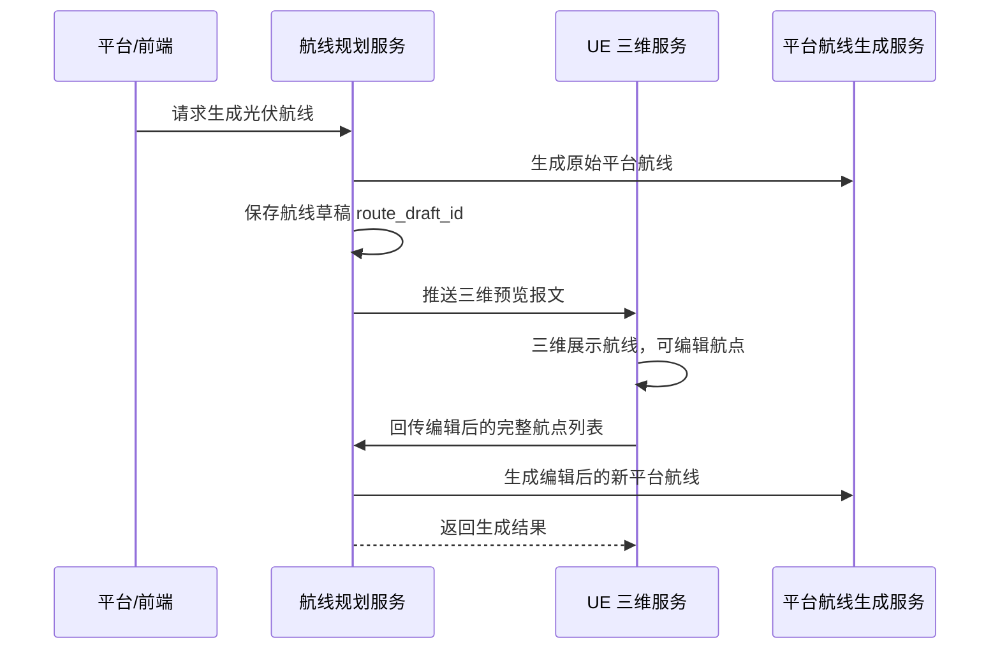

# UE 三维航线预览与编辑回传接口说明

本文档说明航线规划服务与 UE 三维展示/编辑模块之间的对接流程，包含：

1. 平台/前端请求航线规划服务生成光伏航线；
2. 航线规划服务主动推送三维预览报文给 UE；
3. UE 在三维场景中编辑航点后，将编辑结果回传给航线规划服务；
4. 航线规划服务根据编辑结果重新生成平台航线。

## 1. 整体流程



核心约定：

- `route_draft_id` 是三维预览和编辑回传之间的关联 ID。
- UE 编辑回传时必须带原始 `route_draft_id`。
- UE 回传的是编辑后的**完整航点列表**，不是差异列表。
- 新增、删除、移动、重排航点后，都以后端收到的 `waypoints` 数组为准。
- 可见光/红外类型由原始航线的 `imageFormat` 决定，UE 不允许修改航线的相机类型。
- 编辑后生成的新航线名为：`原始航线名 + edited + 时间戳`，不使用下划线等特殊字符。

## 2. 三维预览推送配置

航线规划服务生成光伏航线后，会根据配置决定是否主动推送三维预览报文给 UE。

配置文件：`config/config.json`

```json
{
  "ue3d": {
    "enabled": false,
    "host": "172.20.63.157",
    "port": 5006,
    "path": "/api/route/preview"
  }
}
```

字段说明：

| 字段 | 类型 | 说明 |
|---|---|---|
| `enabled` | boolean | 是否启用三维预览推送 |
| `host` | string | UE 服务地址 |
| `port` | number | UE 服务端口 |
| `path` | string | UE 接收三维预览的路径 |

实际推送地址为：

```text
http://{host}:{port}{path}
```

示例：

```text
http://172.20.63.157:5006/api/route/preview
```

## 3. 航线规划服务推送给 UE 的三维预览报文

### 3.1 请求方向

```text
航线规划服务  ->  UE 三维服务
```

### 3.2 请求方法

```http
POST /api/route/preview
Content-Type: application/json
```

实际路径由 `config/config.json` 中 `ue3d.path` 决定。

### 3.3 报文示例

```json
{
  "route_draft_id": "draft_18b56e5e8ce24d4f_8939db1f0ad47705",
  "route_name": "solar20260603093620",
  "type": "solar",
  "imageFormat": "visable,ir",
  "origin": {
    "lon": 121.365924,
    "lat": 37.5199883,
    "height": 103.0,
    "coord": "geodetic",
    "unit": "meter"
  },
  "areas": [
    {
      "area_name": "光伏区一-区域1",
      "file_suffix": "area01",
      "points": [
        {
          "lon": 121.365924,
          "lat": 37.5199883,
          "height": 103.0
        },
        {
          "lon": 121.3661319,
          "lat": 37.5199622,
          "height": 103.0
        }
      ]
    }
  ],
  "waypoints": [
    {
      "waypoint_id": "wp_0001",
      "index": 0,
      "lon": 121.36593978228544,
      "lat": 37.519907987488125,
      "height": 123.00000639911741,
      "aircraft_heading": 11.936967253985983,
      "camera": {
        "yaw": 11.936967253985983,
        "pitch": -80.0,
        "roll": 0.0,
        "focal_length_35mm": 75.0,
        "hfov": 26.991466561591626,
        "vfov": 20.407947443463367,
        "aspect_ratio": 1.3333333333333333,
        "image_format": "visable",
        "payload_lens_index": "visable",
        "file_suffix": "area01"
      },
      "cameras": [
        {
          "yaw": 11.936967253985983,
          "pitch": -80.0,
          "roll": 0.0,
          "focal_length_35mm": 75.0,
          "hfov": 26.991466561591626,
          "vfov": 20.407947443463367,
          "aspect_ratio": 1.3333333333333333,
          "image_format": "visable",
          "payload_lens_index": "visable",
          "file_suffix": "area01"
        },
        {
          "yaw": 11.936967253985983,
          "pitch": -80.0,
          "roll": 0.0,
          "focal_length_35mm": 52.0,
          "hfov": 38.18698400097123,
          "vfov": 29.1071455814251,
          "aspect_ratio": 1.3333333333333333,
          "image_format": "ir",
          "payload_lens_index": "ir",
          "file_suffix": "area01"
        }
      ]
    }
  ]
}
```

### 3.4 顶层字段说明

| 字段 | 类型 | 必填 | 说明 |
|---|---|---:|---|
| `route_draft_id` | string | 是 | 航线草稿 ID。UE 回传编辑结果时必须原样带回 |
| `route_name` | string | 是 | 原始航线名称 |
| `type` | string | 是 | 航线类型，光伏航线固定为 `solar` |
| `imageFormat` | string | 是 | 原始航线图像类型，可能为 `visable`、`ir`、`visable,ir` |
| `origin` | object | 否 | 三维展示参考原点，取第一个区域的第一个点 |
| `areas` | array | 是 | 巡检区域边界数组 |
| `waypoints` | array | 是 | 三维航线航点数组 |

### 3.5 `imageFormat` 规则

| 值 | 含义 | UE 展示要求 |
|---|---|---|
| `visable` | 可见光 | 每个航点只展示可见光视角 |
| `ir` | 红外 | 每个航点只展示红外视角 |
| `visable,ir` | 可见光 + 红外 | 每个航点同时展示可见光和红外视角 |

注意：当前项目中可见光字符串使用的是历史拼写 `visable`，不是 `visible`。UE 侧应兼容该值。

### 3.6 `areas[]` 字段说明

| 字段 | 类型 | 说明 |
|---|---|---|
| `area_name` | string | 区域名称，仅用于展示 |
| `file_suffix` | string | 区域对应的照片后缀，例如 `area01` |
| `points` | array | 区域边界点，经纬高坐标 |

### 3.7 `waypoints[]` 字段说明

| 字段 | 类型 | 说明 |
|---|---|---|
| `waypoint_id` | string | 航点 ID，例如 `wp_0001` |
| `index` | number | 航点顺序，从 0 开始 |
| `lon` | number | 经度 |
| `lat` | number | 纬度 |
| `height` | number | 高度，单位米 |
| `aircraft_heading` | number | 飞机偏航角，单位度 |
| `camera` | object | 兼容字段，等于 `cameras[0]` |
| `cameras` | array | 当前航点的相机视角数组 |

UE 后续正式开发建议优先使用 `cameras` 数组；`camera` 只是为了兼容单视角调试。

### 3.8 `cameras[]` 字段说明

| 字段 | 类型 | 说明 |
|---|---|---|
| `yaw` | number | 相机偏航角，单位度 |
| `pitch` | number | 相机俯仰角，单位度 |
| `roll` | number | 相机横滚角，当前固定为 `0.0` |
| `focal_length_35mm` | number | 35mm 等效焦距 |
| `hfov` | number | 水平视场角，单位度 |
| `vfov` | number | 垂直视场角，单位度 |
| `aspect_ratio` | number | 画幅比例，当前为 `4032 / 3024 = 1.3333333333333333` |
| `image_format` | string | 相机类型：`visable` 或 `ir` |
| `payload_lens_index` | string | 镜头索引：`visable` 或 `ir` |
| `file_suffix` | string | 当前航点所属区域照片后缀 |

焦距规则：

- 可见光焦距来自航线规划服务配置 `solar.focalLength`；
- 红外 35mm 等效焦距固定为 `52.0`；
- `hfov` / `vfov` 由后端根据焦距计算，UE 可直接用于视锥展示。

视场角计算公式：

```text
hfov = 2 * atan(36 / (2 * focal_length_35mm))
vfov = 2 * atan(27 / (2 * focal_length_35mm))
```

角度单位为度。

## 4. UE 编辑后回传给航线规划服务的报文

### 4.1 请求方向

```text
UE 三维服务  ->  航线规划服务
```

### 4.2 请求地址

```http
POST http://172.20.63.157:5001/solar/edited
Content-Type: application/json
```

### 4.3 设计原则

UE 回传编辑结果时，不需要把三维预览原文完整发回。

UE 只需要回传：

- 原始 `route_draft_id`；
- 编辑后的完整航点列表；
- 每个航点的位置、姿态和焦距。

后端会根据原始草稿自动补齐：

- 原始 `imageFormat`；
- 原始相机类型；
- 区域照片后缀；
- 平台航线动作结构；
- 新航线名称。

### 4.4 UE 回传报文示例

```json
{
  "route_draft_id": "draft_18b56e5e8ce24d4f_8939db1f0ad47705",
  "waypoints": [
    {
      "lon": 121.36593978228544,
      "lat": 37.519907987488125,
      "height": 123.0,
      "aircraft_heading": 11.94,
      "pitch": -80.0,
      "visible_focal_length_35mm": 75.0,
      "ir_focal_length_35mm": 52.0
    },
    {
      "lon": 121.3660132039725,
      "lat": 37.51989562422538,
      "height": 123.0,
      "aircraft_heading": 11.94,
      "pitch": -80.0,
      "visible_focal_length_35mm": 75.0,
      "ir_focal_length_35mm": 52.0
    }
  ]
}
```

### 4.5 UE 回传顶层字段说明

| 字段 | 类型 | 必填 | 说明 |
|---|---|---:|---|
| `route_draft_id` | string | 是 | 原始三维预览报文中的草稿 ID |
| `waypoints` | array | 是 | 编辑后的完整航点列表，不能为空 |

### 4.6 UE 回传 `waypoints[]` 字段说明

| 字段 | 类型 | 必填 | 说明 |
|---|---|---:|---|
| `lon` | number | 是 | 修改后的航点经度 |
| `lat` | number | 是 | 修改后的航点纬度 |
| `height` | number | 是 | 修改后的航点高度，单位米 |
| `aircraft_heading` | number | 是 | 修改后的飞机偏航角，单位度 |
| `pitch` | number | 是 | 修改后的云台俯仰角，单位度 |
| `visible_focal_length_35mm` | number | 否 | 可见光 35mm 等效焦距 |
| `ir_focal_length_35mm` | number | 否 | 红外 35mm 等效焦距，默认 `52.0` |

说明：

- 如果原始航线是 `visable`，后端使用 `visible_focal_length_35mm`。
- 如果原始航线是 `ir`，后端使用 `ir_focal_length_35mm`。
- 如果原始航线是 `visable,ir`，当前平台航线生成逻辑使用可见光焦距，红外焦距固定为 `52.0`，无需 UE 额外处理。
- 如果焦距字段未传，后端使用默认值。

### 4.7 新增、删除、重排航点规则

UE 回传的是编辑后的完整航点数组，因此：

- 修改航点：修改对应航点的经纬高、偏航、俯仰、焦距后回传完整数组；
- 新增航点：把新增航点插入 `waypoints` 数组对应位置；
- 删除航点：从 `waypoints` 数组中移除该航点；
- 调整顺序：按最终飞行顺序排列 `waypoints` 数组。

后端不依赖 `waypoint_id` 或 `index` 判断最终顺序，只按 `waypoints` 数组顺序生成航线。

### 4.8 相机类型约束

UE 不允许在回传报文中修改相机类型。

也就是说：

- 原始航线是 `visable`，编辑后仍然只能是可见光航线；
- 原始航线是 `ir`，编辑后仍然只能是红外航线；
- 原始航线是 `visable,ir`，编辑后仍然保持可见光 + 红外配置。

新增航点也必须继承原始航线的相机类型。

## 5. 航线规划服务返回给 UE 的编辑结果

### 5.1 成功返回示例

```json
{
  "code": 0,
  "message": "航线编辑成功",
  "data": {
    "route_draft_id": "draft_18b56e5e8ce24d4f_8939db1f0ad47705",
    "waypoints": 2,
    "imageFormat": "visable,ir",
    "platform_response": {
      "status": 200
    },
    "platform_route": {
      "routeName": "solar20260603093620edited20260603181230",
      "templateType": "waypoint",
      "totalPoints": 2,
      "routePointList": []
    }
  }
}
```

### 5.2 返回字段说明

| 字段 | 类型 | 说明 |
|---|---|---|
| `code` | number | `0` 表示处理成功 |
| `message` | string | 处理结果描述 |
| `data.route_draft_id` | string | 原始草稿 ID |
| `data.waypoints` | number | 本次回传航点数量 |
| `data.imageFormat` | string | 原始航线图像类型 |
| `data.platform_response.status` | number | 平台航线生成服务 HTTP 状态码 |
| `data.platform_route` | object | 后端生成的平台航线报文 |

注意：`platform_response` 当前只返回状态码，不返回平台响应体。原因是平台响应体可能包含非 UTF-8 编码内容，直接放入 JSON 可能导致编码异常。

### 5.3 失败返回示例

缺少 `route_draft_id`：

```json
{
  "code": 400,
  "message": "缺少 route_draft_id"
}
```

草稿不存在：

```json
{
  "code": 404,
  "message": "草稿不存在: draft_xxxxx"
}
```

航点为空：

```json
{
  "code": 400,
  "message": "waypoints 不能为空"
}
```

服务内部异常：

```json
{
  "code": 500,
  "message": "错误信息"
}
```

## 6. 航线命名规则

原始航线由自动航线生成流程命名，例如：

```text
solar20260603093620
```

编辑后生成新航线，命名规则为：

```text
基础航线名 + edited + 时间戳
```

例如：

```text
solar20260603093620edited20260603181230
```

多次编辑不会无限追加 `edited`。如果原始名称中已经包含 `edited`，后端会先截取 `edited` 前面的基础名称，再拼接新的编辑时间戳。

示例：

```text
solar20260603093620edited20260603181230
```

再次编辑后：

```text
solar20260603093620edited20260603182010
```

## 7. 草稿保存规则

航线规划服务本地保存草稿，目录为：

```text
/workspace/build/route_drafts/
```

自动生成航线后保存：

```text
{route_draft_id}.json
```

编辑回传后保存：

```text
{route_draft_id}_edited.json
```

原始草稿中保存：

- 原始请求；
- 平台航线数据；
- 三维预览数据。

编辑草稿中保存：

- 编辑后的航点配置；
- 编辑后生成的平台航线报文；
- 平台航线生成服务状态码。

## 8. UE 侧开发建议

### 8.1 三维预览阶段

UE 收到三维预览报文后：

1. 保存 `route_draft_id`；
2. 根据 `areas` 绘制巡检区域；
3. 根据 `waypoints` 绘制航线；
4. 根据 `cameras` 绘制可见光/红外视锥；
5. 根据 `imageFormat` 决定展示一个视角还是两个视角。

### 8.2 编辑回传阶段

UE 编辑完成后：

1. 使用原始 `route_draft_id`；
2. 生成编辑后的完整 `waypoints` 数组；
3. 不需要回传 `areas`、`camera`、`cameras`、`hfov`、`vfov`、`file_suffix`；
4. 调用 `/solar/edited`；
5. 根据返回的 `code` 判断是否成功。

### 8.3 不需要 UE 回传的字段

以下字段不需要 UE 在编辑接口中回传：

- `areas`
- `origin`
- `route_name`
- `type`
- `imageFormat`
- `waypoint_id`
- `index`
- `camera`
- `cameras`
- `hfov`
- `vfov`
- `aspect_ratio`
- `file_suffix`

这些字段由航线规划服务根据原始草稿和编辑后的航点自动处理。

## 9. 测试命令示例

```bash
curl -X POST "http://172.20.63.157:5001/solar/edited" \
  -H "Content-Type: application/json" \
  -d '{
    "route_draft_id": "draft_18b56e5e8ce24d4f_8939db1f0ad47705",
    "waypoints": [
      {
        "lon": 121.36593978228544,
        "lat": 37.519907987488125,
        "height": 123.0,
        "aircraft_heading": 11.94,
        "pitch": -80.0,
        "visible_focal_length_35mm": 75.0,
        "ir_focal_length_35mm": 52.0
      },
      {
        "lon": 121.3660132039725,
        "lat": 37.51989562422538,
        "height": 123.0,
        "aircraft_heading": 11.94,
        "pitch": -80.0,
        "visible_focal_length_35mm": 75.0,
        "ir_focal_length_35mm": 52.0
      }
    ]
  }'
```

## 10. 当前限制与后续扩展

当前 `/solar/edited` 只支持“先由航线规划服务生成航线，再由 UE 编辑并回传”的流程。

如果后续需要支持“UE 直接在三维模型上选点并生成新航线”，建议新增独立接口，例如：

```text
/solar/create_from_ue
```

该接口不依赖 `route_draft_id`，由 UE 直接传入航线名称、图像类型、航点列表等信息。该能力目前尚未实现。
