# 工地巡检平台操作手册

东方电子股份有限公司

固定部署与移动部署 · 图文操作版

版本：V1.0　编制日期：2026年11月5日

适用页面：变量管理—施工区域；任务管理—工地巡检计划；飞行任务—工地巡检任务结果。

## 阅读说明

本手册面向现场飞手、巡检人员及站内结果复核人员，说明从工作面管理、航线配置、计划执行，到原图归档、离线交接、回站分析和报告下载的操作过程。设备绑定、Linux安装及算法服务部署由系统维护人员完成，本手册不替代设备飞行操作规程。

本手册截图直接取自当前运行的前端页面，使用隔离的演示接口数据。示例工作面、机巢、照片、人数、温度和目录均用于说明操作，不代表现场真实记录。图中底图未加载时，仅展示实际页面的机巢、边界及航线图层；现场使用前应确认地图服务可用。截图中的温度、半径和飞行参数不是现场推荐值。

截图按操作步骤编号，图下“读图指引”说明按钮位置。Word中可放大截图查看文字，原始PNG随手册提供。平台升级后，局部文字和布局可能变化，以现场安装版本为准。

### 目录

1. 两种部署与完整作业流程
2. 变量管理—施工区域
3. 区域航线与检测配置
4. 任务管理—工地巡检计划
5. 总体航线：一次巡检多个工作面
6. 飞行任务—本地照片与离线交接
7. 回站分析、结果复核与报告
8. 固定端、移动端操作清单
9. 常见问题与处理

## 1 两种部署与完整作业流程

### 1.1 固定端与移动端如何分工

固定机巢与车载机巢分别连接一台安装平台的Linux笔记本，两端使用同一套软件，均可独立管理工作面、创建计划、接收原图、导出或接收任务包。两端均可在具备分析条件时发起分析，并非只有移动端拥有分析功能。

| 项目 | 固定部署 | 移动部署 |
| --- | --- | --- |
| 机巢位置 | 通常固定，按实际定位配置覆盖范围 | 随车辆转场，作业前核对新位置 |
| 日常工作 | 巡检附近工作面，保存原图与任务结果 | 在不同驻车位置开展巡检，保存本机结果 |
| 驻车点用途 | 可查看，不作为固定机巢位置替代 | 预先比较驻车位置与可覆盖工作面 |
| 数据交接 | 导出完整离线任务包交给接收端 | 接收固定端任务包，保留本机采集结果 |
| 回站分析 | 笔记本带回站内后也可分析 | 通常统一携带两端结果回站，逐任务分析 |

“脱网独立运行”表示现场采集不依赖站内分析服务。笔记本、机巢及平台所需的现场网络仍须可用；地图底图是否离线可用取决于现场地图资源配置。

### 1.2 三个页面各负责什么

| 页面 | 主要操作 | 操作后得到什么 |
| --- | --- | --- |
| 变量管理 → 施工区域 | 标定工作面、配置覆盖范围和驻车点、关联航线、设置检测项 | 可供计划引用的区域、航线和规则 |
| 任务管理 → 工地巡检计划 | 按机巢和工作面选择计划、新建计划、下发任务 | 一次实际飞行任务 |
| 任务管理 → 飞行任务 → 工地结果 | 保存照片、交接离线包、分析、复核、生成报告 | 原图、批次结果及Word报告 |

整体操作顺序：确认机巢位置 → 划定工作面 → 配置航线与检测项 → 新建计划 → 下发并执行 → 照片收齐并保存到本地 → 必要时离线交接 → 回站检查分析能力 → 手动分析 → 复核并导出报告。

### 1.3 开始操作前

1. 登录本机平台，进入正确的工作空间。
2. 确认本端机巢已绑定，现场网络正常，平台能获取机巢定位。
3. 确认本地磁盘有足够空间保存原图和后续分析结果。
4. 固定端与移动端应有各自的部署编号。交接任务使用任务包，不复制另一端整个数据库或部署数据目录。
5. 正式下发前由飞手核对设备状态、航线高度、起降条件和现场障碍物。

## 2 变量管理—施工区域

### 2.1 认识施工区域页面

打开“变量管理 → 施工区域”。左侧是区域台账，中间是地图，右侧显示当前区域的检测配置、航线或详情。选择左侧工作面或点击地图区域，可查看对应内容。

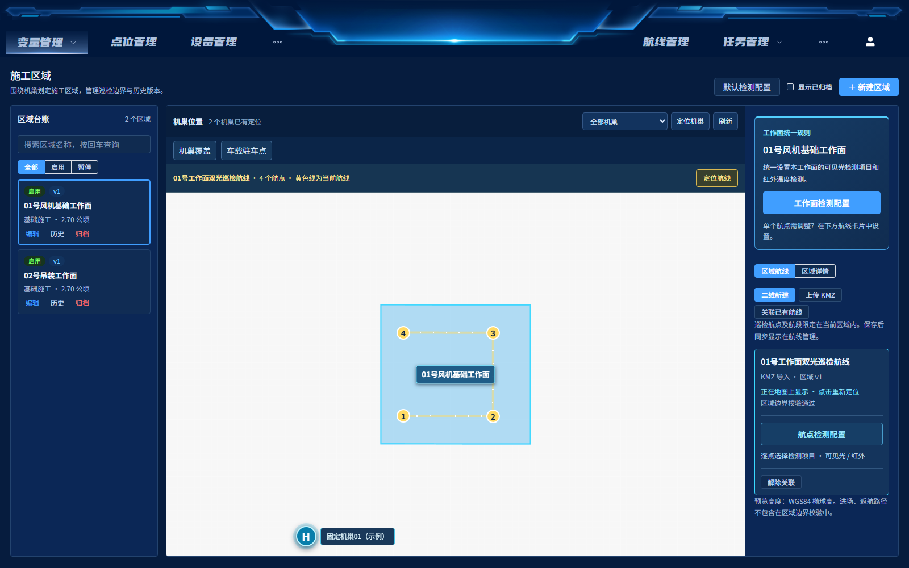

读图指引：左侧用于选择和搜索工作面；地图显示区域名称、机巢与航点；右侧“区域航线”用于二维新建、上传KMZ、关联已有航线。点击航线卡片后，地图显示黄色航线和编号航点，“定位航线”用于重新定位。

### 2.2 配置机巢覆盖范围

1. 在地图上方的机巢下拉列表中选择本次作业机巢。
2. 点击“定位机巢”，核对标记位置是否与现场一致。缺少定位时先检查设备连接和定位上报，不以人工驻车点冒充实时定位。
3. 展开“机巢覆盖”，设置覆盖半径。可用100m、2km、5km快捷值，或填写100～5000米整数。
4. 点击“保存范围”。确认页面出现已保存半径；仅修改输入框而未保存，不代表新的范围已生效。
5. 查看覆盖圈及覆盖工作面列表。“完全覆盖”表示整个区域在圈内；“部分覆盖”表示只覆盖部分区域。

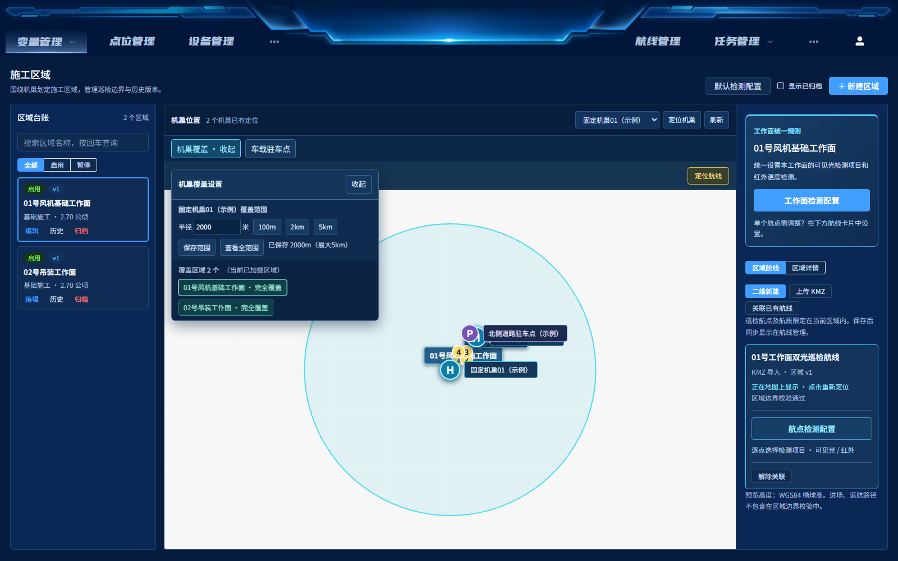

读图指引：“机巢覆盖”面板提供半径输入、“保存范围”和覆盖区域列表。计划页按已保存范围筛选，不能仅凭区域中心位于圆内判断可执行。

固定部署通常在初次配置或范围调整时设置。移动部署每次转场后需重新确认实际机巢定位及其覆盖工作面。覆盖圈只是区域筛选依据，不等于障碍物、航程、电量或空域检查已经通过。

### 2.3 标定车载驻车点

1. 展开地图上方“车载驻车点”，点击“＋ 标定驻车点”。
2. 填写便于识别的名称，例如“北侧道路驻车点”。在地图上单击选择预设位置。
3. 设置覆盖半径并保存。已保存驻车点可在下拉列表中选择，也可点击地图上的P标记。
4. 选中驻车点后，查看紫色选中动效、覆盖圈和覆盖工作面列表。
5. 选择当前机巢后，查看机巢到驻车点的虚线及距离。该距离为平面位置计算的直线距离，不是车辆道路行驶里程。
6. 用“编辑”调整名称、位置或半径；需要移除时点击“删除”并确认。

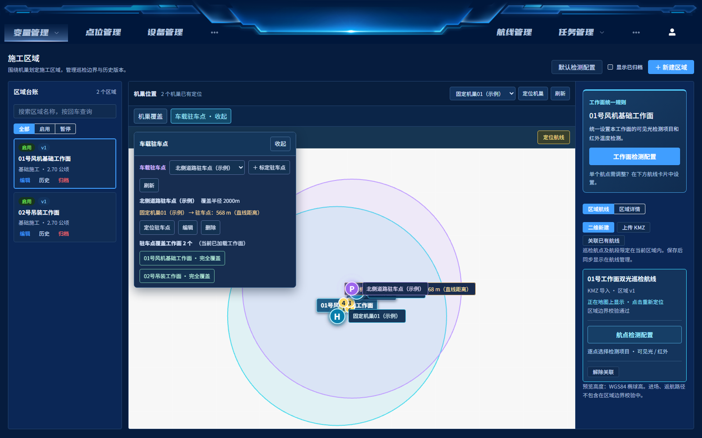

读图指引：浮动面板列出选中驻车点和覆盖工作面；地图上的P表示预设驻车点，H表示机巢。驻车点不会改变机巢真实位置，也不会自动切换计划执行机巢。车辆到达后仍需等待真实定位更新。

覆盖列表以当前加载的工作面为准，搜索、状态和归档筛选可能影响所列范围。两端的驻车点不会随离线任务包自动同步。

### 2.4 新建或编辑工作面

1. 点击右上角“＋ 新建区域”。
2. 输入区域名称，选择施工类型，按需填写备注；确认是否允许创建巡检计划。
3. 使用地图绘制工具沿工作面边界标定多边形，并完成绘制。至少需要三个有效顶点，避免边界交叉。
4. 核对边界顶点数量、面积和现场位置。确认无误后点击“保存区域”。
5. 已有区域可从左侧卡片点击“编辑”。保存修改后生成新版本；“历史”可查看版本记录。

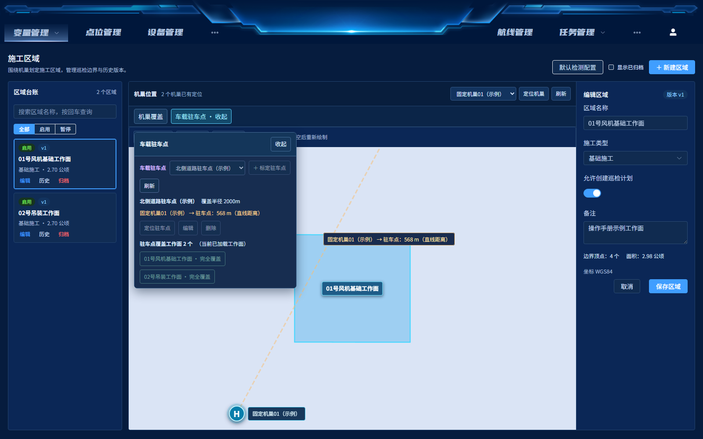

读图指引：右侧用于编辑名称、类型、启用状态和备注；地图用于调整边界；右下角“保存区域”提交修改，“取消”放弃本次编辑。

### 2.5 暂停、归档及恢复

关闭“允许创建巡检计划”可暂停区域使用。区域卡片“归档”用于将不再使用的区域退出日常列表，历史任务仍保留。需要恢复区域时，勾选“显示已归档”，找到该区域并点击“恢复”。

区域恢复后，应重新核对关联航线和计划状态。区域边界变化可能使原航线关联失效；按提示重新校验，不继续使用状态异常的关联。注意：区域可恢复，不代表已归档的巡检计划也有恢复入口。

## 3 区域航线与检测配置

### 3.1 三种区域航线来源

选择工作面后，在右侧“区域航线”中操作。新建或上传的航线也会出现在平台“航线管理”列表中；施工区域页面管理的是航线与工作面的关联。

| 入口 | 适用情况 | 操作要点 |
| --- | --- | --- |
| 二维新建 | 在该工作面内进行地图规划 | 进入编辑器，设置航点及动作，检查后提交 |
| 上传 KMZ | 已有飞手录制或其他工具导出的航线 | 选择KMZ，等待解析及区域边界校验 |
| 关联已有航线 | 文件已经在航线管理中 | 搜索航线，点击“校验并关联” |

区域航线要求巡检航点和航段位于当前区域内。跨多个工作面的完整航线应进入“总体航线与计划”，不要强行绑定为单区域航线。进场和返航路径不包含在区域内巡检航段校验中，仍需飞手检查。

选中航线卡片可查看地图预览。校验未通过或标为失效时，先处理提示原因；“重新校验”用于校验旧关联，“解除关联”解除当前工作面的关联，不表示删除全部历史任务。

### 3.2 二维编辑与自动生成S型航线

1. 在区域航线中点击“二维新建”，确认编辑器显示正确的工作面名称和蓝色边界。
2. 选择具有有效实时椭球高的参考机巢。参考机巢用于生成航高，不代表计划已下发。
3. 需要自动覆盖工作面时，点击“自动生成 S 型航线”。填写方向、扫描行间距、拍照点间距、相对高度、速度、云台俯仰角和拍照镜头。
4. 点击“计算航线”，查看扫描线数、航点数、拍照点数和估算长度。
5. 点击“应用到编辑器”，检查地图上的航点和连线，必要时调整航点位置、参数及动作。
6. 检查航线名称、执行高度、拍照镜头、云台动作和安全起飞设置，最后点击“提交”。保存后返回区域航线列表检查状态。

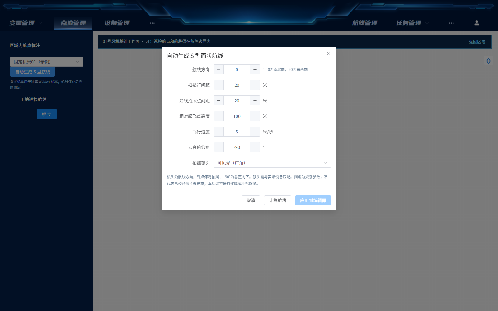

读图指引：“计算航线”只计算预览，“应用到编辑器”将计算结果填入编辑器，最后仍需“提交”才能保存航线。手动调整时以编辑器显示的航点与动作参数为准。

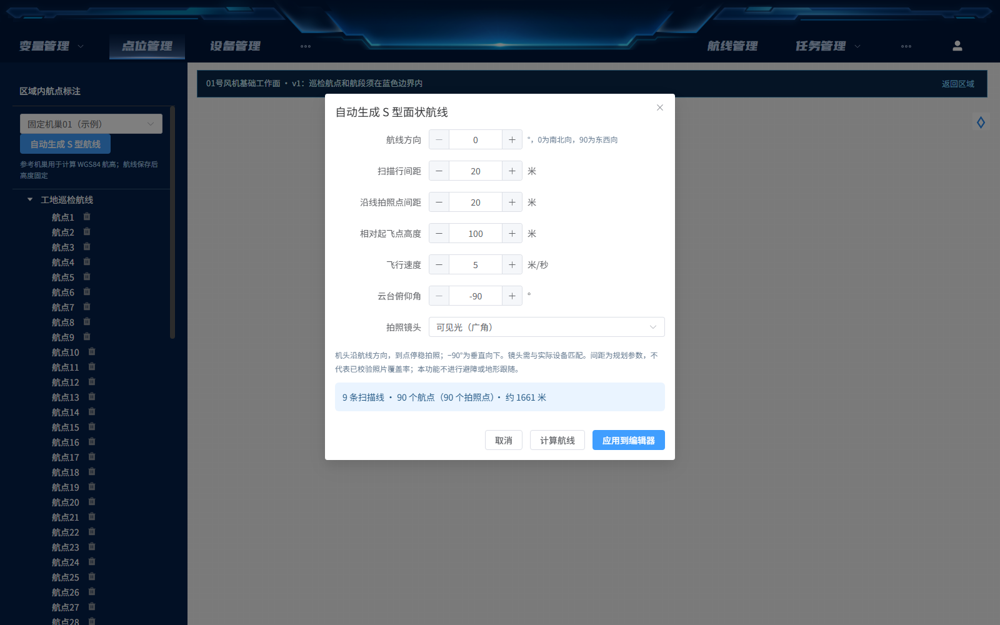

读图指引：弹窗底部显示计算出的扫描线数、航点数和长度，点击“应用到编辑器”后检查地图。正式作业时确认扫描线位于蓝色边界内、航点编号和连线方向合理。地图箭头表示方向，航点动作中的云台俯仰角决定到点拍照角度。

高度说明：工地生成航线使用参考机巢WGS84椭球高加填写的相对高度，得到WGS84绝对航高。例如机巢椭球高30米、相对高度100米，生成航点高度为130米。航线保存后高度固定，不会随车载机巢转场自动增加或降低；转场、高程变化后必须复核，必要时重新生成航线。

界面中“相对起飞点高度”在此流程中用于上述生成换算，不是地形跟随高度。安全起飞高度、返航高度与航点绝对航高分别检查。云台−90°为垂直向下，0°为水平；生成机头默认沿航线方向。扫描线填满区域不代表照片覆盖率已验证，也不包含自动避障判断。

### 3.3 检测规则的三级配置

检测优先级：航点独立配置 ＞ 工作面独立配置 ＞ 工作空间默认配置。每一级保存的是整套规则；继承与“全部取消检测”是不同操作。

| 配置层级 | 页面入口 | 适合设置的内容 |
| --- | --- | --- |
| 默认配置 | 施工区域页右上角“默认检测配置” | 多数工作面共用的基础检测项 |
| 工作面配置 | 选中区域后右侧“工作面检测配置” | 本工作面统一开启或关闭的检测项 |
| 航点配置 | 区域航线卡片或总体航线的“航点检测配置” | 某个拍摄视角的独立检测要求 |

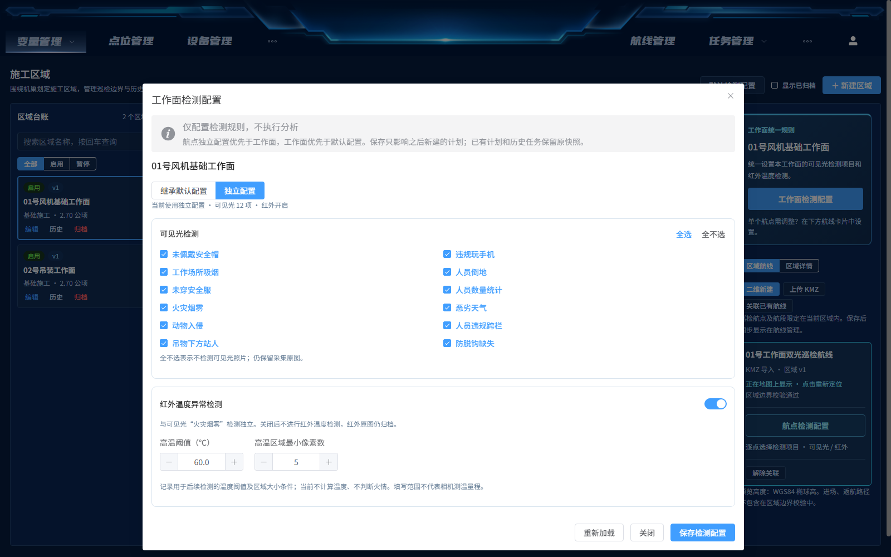

工作面操作：选择“继承默认配置”沿用默认规则，或选择“独立配置”后勾选检测项，最后点击“保存检测配置”。可见光暂定12类包括安全帽、玩手机、吸烟、倒地、安全服、人数、火灾烟雾、恶劣天气、动物入侵、跨栏、吊物下方站人和防脱钩缺失。实际能否检测取决于分析服务中相应模型是否就绪。

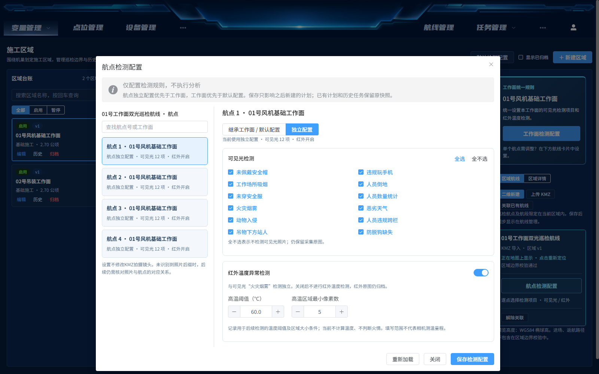

航点操作：从左侧选择航点，核对所属工作面；选择继承或独立配置，修改后保存，再切换其他航点。未绑定工作面的总体航点应先完成绑定。替换航线文件后重新检查规则，不凭相同航点号默认沿用旧文件配置。

### 3.4 红外分析开关与配置生效时间

红外温度异常检测与可见光“火灾烟雾”是两个独立项目。开启红外后填写高温阈值和高温区域最小像素数；阈值由现场要求确定。截图的60℃、5像素仅为示例。

配置检测规则不会改变KMZ的拍照镜头，也不会让可见光照片变成可测温红外照片。需要红外分析时，航线本身要采集受支持的红外原图，平台本地测温SDK也需可用。关闭检测后原图仍可保存。

规则在新建计划时冻结。已有计划、已执行任务和旧分析批次保留原配置；仅修改工作面或航点规则，再对旧任务点击“重新分析”，不会自动采用新规则。需要按新规则作业时，保存配置后重新创建计划。

## 4 任务管理—工地巡检计划

### 4.1 按机巢和工作面查找计划

1. 打开“任务管理 → 工地巡检计划”。
2. 在地图上方选择执行机巢，确认实时位置和已保存覆盖半径。
3. 左侧列出当前机巢完全覆盖的区域。点击目标工作面，下方显示该区域关联的计划列表。
4. 点击计划行，查看对应航线在地图上的预览。使用搜索框筛选计划名称。

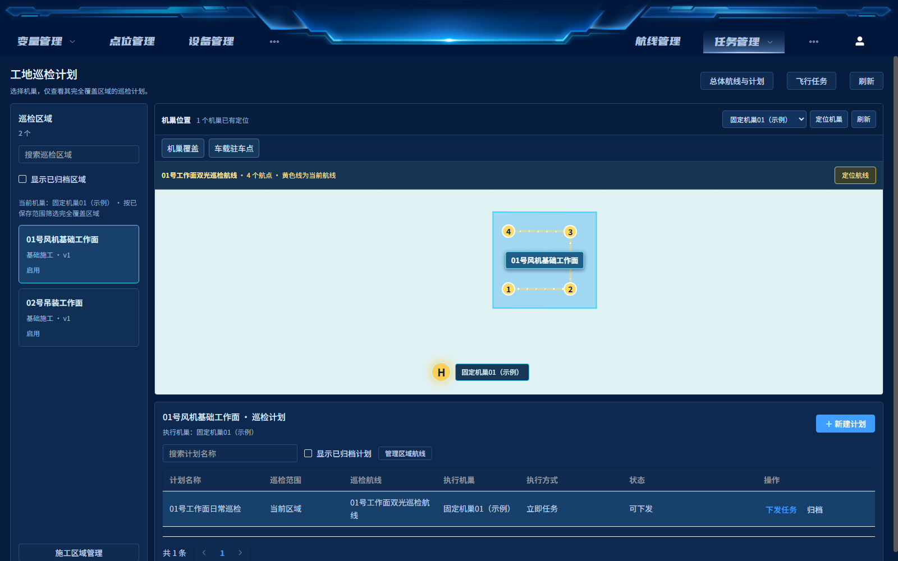

读图指引：左侧选择工作面；地图上方选择机巢；地图下方查看计划、状态和操作。区域仅部分覆盖、机巢缺少定位或未保存范围时，区域可能不会进入可选列表。总体计划涉及的各工作面也须满足覆盖条件。

### 4.2 新建区域计划

1. 选择已启用且未归档的工作面，点击“＋ 新建计划”。
2. 填写计划名称，建议包含工作面和用途，便于后续查找。
3. 从“巡检航线”中选择该区域已绑定且校验有效的航线。单区域计划要求有效的WGS84绝对航高航线；旧相对高度航线按提示重新生成。
4. 选择执行机巢。选择“立即任务”或“定时任务”；定时任务填写未来执行时间。
5. 核对返航高度和失联动作。返航高度不用于替代巡检航点的飞行高度。
6. 点击“保存计划”，确认新计划出现在列表中。此时尚未下发飞行。

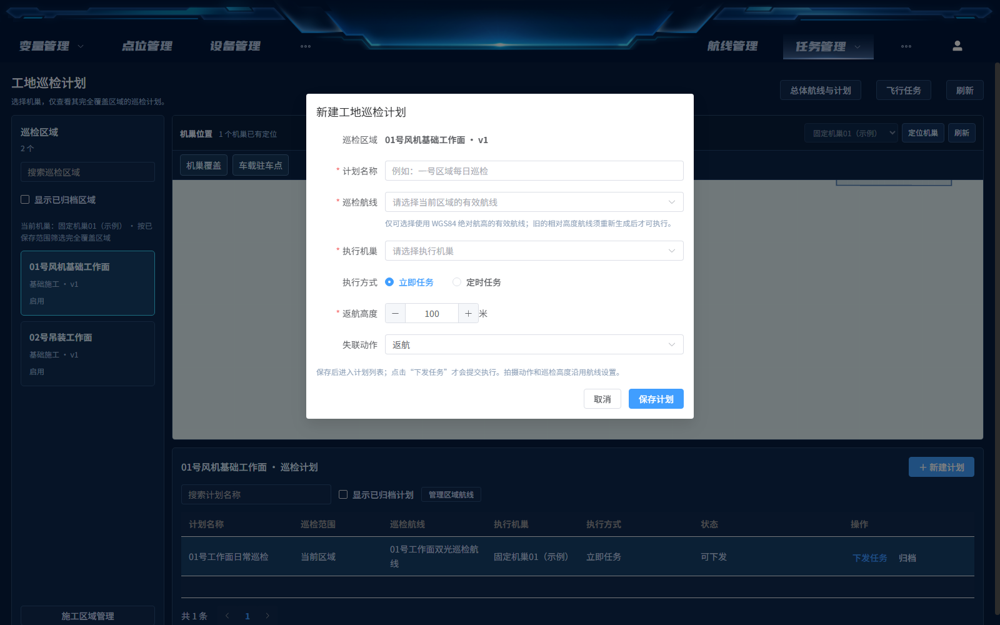

读图指引：弹窗顶部显示所属区域；依次填写名称、航线、机巢、执行方式及安全相关参数；右下角“保存计划”仅保存计划配置。

### 4.3 下发与查询

核对计划状态显示“可下发”后，点击“下发任务”，阅读确认提示，由具备现场操作权限的人员确认下发。随后进入“飞行任务”查看实际任务状态与媒体上传情况。

下发成功表示任务已提交，不表示飞行和照片回传已经完成。若显示“提交中”或“待确认”，使用“查询下发”核对原请求结果，不连续重复提交同一任务。定时任务也需要先下发，才进入设备执行流程。

### 4.4 归档计划

“归档”用于停止该计划继续下发，历史任务、原图及分析记录保留。勾选“显示已归档计划”可查看历史计划。当前计划页没有恢复已归档计划的入口；需要再次执行时重新创建计划。活动任务存在时，按页面提示先处理活动任务。

## 5 总体航线：一次巡检多个工作面

### 5.1 上传入口

在“工地巡检计划”右上角点击“总体航线与计划”。选择机巢后，可点击“上传 KMZ”，或“从航线库添加”选择已有航线。该入口适合一条完整航线覆盖多个工作面的情况，上传文件仍进入平台航线库。

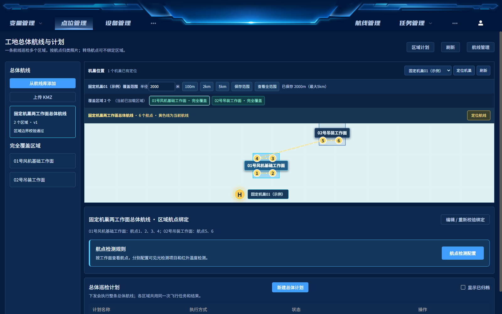

读图指引：左侧上传或选择总体航线；中间地图查看整条航线；下方显示工作面绑定、航点检测配置和总体巡检计划。

### 5.2 把航点绑定到工作面

1. 上传或选择航线并解析。已有总体航线可点击“编辑 / 重新校验绑定”。
2. 在工作面下拉框选择一个完全覆盖的区域。
3. 勾选航点列表左侧复选框，或点击地图航点；一个工作面可以选择多个航点。
4. 点击“绑定选中航点”。重复操作，为其他工作面分配航点。
5. 可用“按位置预选当前区域航点”辅助选择，但仍需人工核对实际拍摄对象。航点位置在某区域内，不一定代表镜头拍摄的就是该区域。
6. 核对列表中的“绑定巡检区域”，点击“保存绑定”。一个航点只能归属一个工作面，转场点可不绑定。

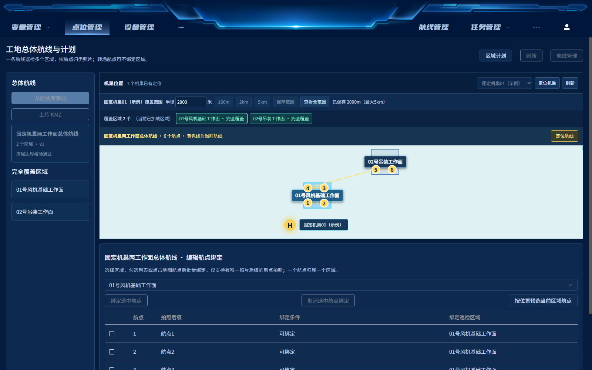

读图指引：先选择区域，再勾选航点并点击“绑定选中航点”；“取消选中航点绑定”清除误绑定；最后“保存绑定”提交整套关系。

若航点不能勾选，查看“绑定条件”。当前绑定需要能区分拍照归属的唯一标识。手飞录制航线若已有“航点1”“航点2”等唯一照片后缀，可用于关联；缺少标识时按平台解析提示处理执行版。平台可处理的情况会补齐拍照标识并保留上传原件；无法可靠处理的情况应修正航线，不能忽略错误强行绑定。

### 5.3 配置规则并新建总体计划

保存绑定后点击“航点检测配置”，按工作面逐点设置。随后点击“新建总体计划”，填写方式与区域计划相同，保存后在总体计划列表下发。

执行总体计划会飞完整条航线，生成一次飞行任务和一份任务结果。结果页通过工作面分组显示照片，不会因为绑定两个工作面就生成两份独立飞行结果。更改总体绑定后，按新绑定重新创建计划，旧计划保留原快照。

## 6 飞行任务—本地照片与离线交接

### 6.1 找到工地巡检结果

进入“任务管理 → 飞行任务”，按任务名称、任务时间或计划类型查找工地巡检任务，从该任务的结果入口进入。通过离线任务包接收的任务位于同页的“离线接收工地巡检结果”分组，点击“查看任务结果”。

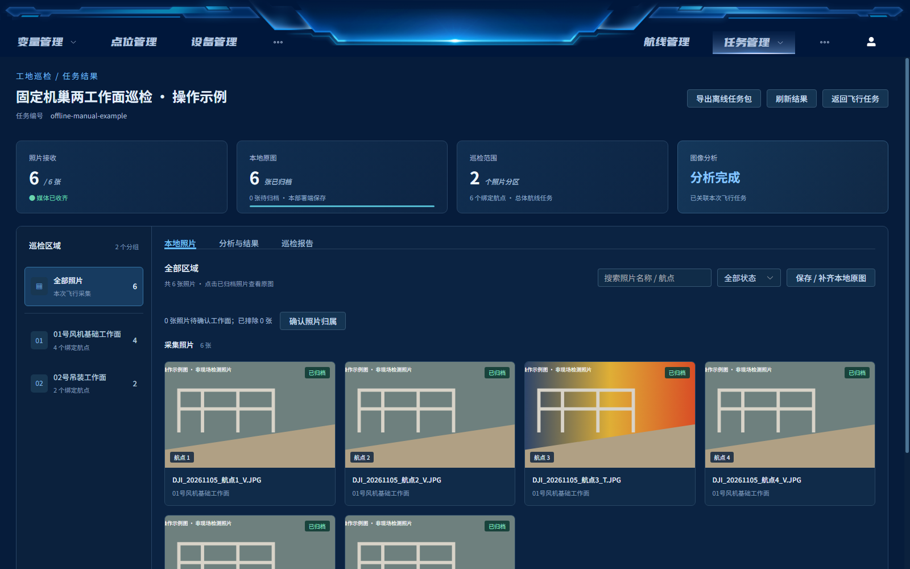

读图指引：顶部查看照片接收、本地归档、巡检范围与分析状态；左侧按工作面筛选；右侧三个页签为“本地照片”“分析与结果”“巡检报告”。

### 6.2 保存和检查原图

1. 等待照片回传完成，核对“照片接收”数量及“媒体已收齐”状态。
2. 在“本地照片”点击“保存 / 补齐本地原图”，将待归档照片补齐到本部署端。
3. 确认已归档数量与任务照片数量一致。点击照片可打开原图，查看工作面和航点信息，按需“下载原图”。
4. 通过左侧工作面、照片名称/航点搜索和归档状态筛选，检查遗漏照片。

浏览器能显示缩略图不等于原图已完整归档。交接离线包前，以媒体收齐和本地原图状态为准。不要手工删除或改名数据目录中的清单、锁文件或原图。

### 6.3 处理未匹配照片

总体任务中出现“未匹配 / 未绑定”分组时，点击“确认照片归属”。勾选照片、查看原图后，可确认其属于本次任务的哪个工作面；不参加分析的转场或测试照片可选择“排除分析”，填写原因后保存。

排除分析不会删除原图。人工确认工作面也不等于补齐了唯一航点和冻结检测规则；如果后续仍提示缺少航点或策略，交由维护人员核对，不把照片随意归入其他工作面。分析进行中照片归属可能锁定；修改归属后旧结果仍属于旧版本，需要重新分析。

### 6.4 固定端导出离线任务包

固定端完成飞行并收齐照片后，在结果页右上角点击“导出离线任务包”。等待页面显示“离线任务包已生成”及完整路径，然后在固定端笔记本文件系统中找到该ZIP。

离线包包含任务来源、执行时工作面与航点快照、照片清单、原始照片及已有人工归属。它不等于整个平台备份，不携带账号、机巢绑定、可执行计划或既有分析报告。接收端会创建本机分析批次。

包路径是后端所在Linux笔记本的路径，不是当前浏览器的下载目录。正常使用时保持ZIP完整，不自行解压后挑选照片，也不手工修改包内清单。

### 6.5 移动端接收固定端数据

1. 在移动端打开“飞行任务”，点击“离线接收工地巡检结果”。
2. 展开“拷贝目录与使用方法”，记录本端界面显示的实际接收目录。
3. 通过U盘或现场局域网，把固定端导出的ZIP完整复制到该目录。复制过程中可用.part后缀，完成后改回.zip；也可先复制到目录外，再将完整文件移入。
4. 点击“刷新并接收”，等待显示接收结果。仅打开列表不会自动接收尚未处理的数据包。
5. 核对接收任务名称、来源部署、机巢、执行时间和照片数量，点击“查看任务结果”，抽查原图。

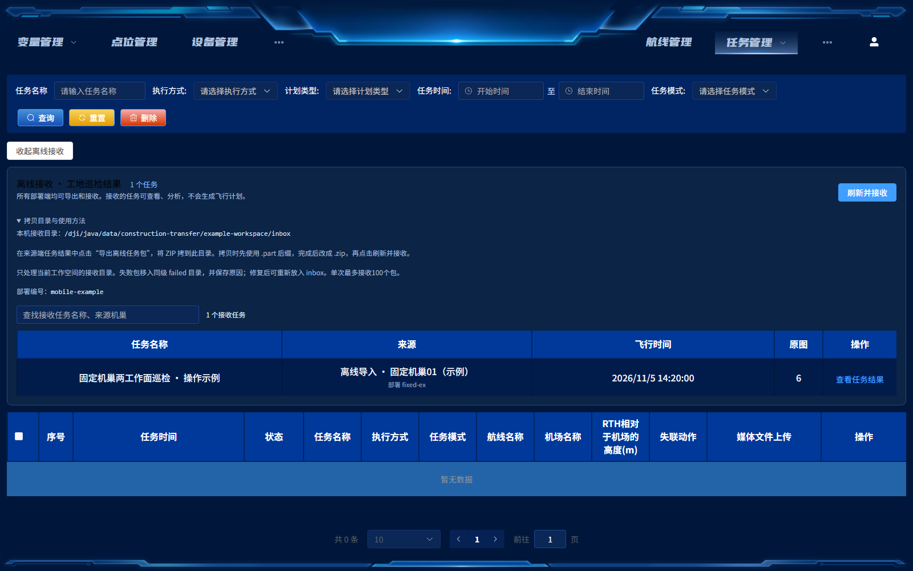

读图指引：展开目录说明后读取“接收目录”；复制完成后点击“刷新并接收”；成功接收的任务在下方列表进入结果页。截图中的example-workspace只用于示例，不能直接作为现场路径使用。

路径形如“/dji/java/data/construction-transfer/工作空间派生编号/inbox”。中间编号由平台按当前工作空间生成；部署编号用于识别来源电脑，由平台自动生成并保留。无需人工编造编号，始终复制到接收端页面显示的目录。

相同任务包再次接收会跳过；同一来源任务内容冲突时不会静默覆盖。失败时按回执检查是否复制完整或原图损坏，必要时在来源端重新导出。接收成功的离线任务是历史结果，不支持由移动端重新下发或控制来源固定机巢。

### 6.6 固定与移动端交接示例

固定端产生任务A，移动端自己产生任务B。车辆到固定端后，将任务A的ZIP复制到移动端接收目录并接收。移动端保留任务A和任务B两份结果。回站后分别进入A、B的结果页提交分析；即使同一天、同一个工作面，也不把两次飞行的人数直接合并为一次去重结果。

## 7 回站分析、结果复核与报告

### 7.1 连接站内网络与检查能力

将承担分析的笔记本接入站内网络，确认可以访问分析服务器。进入目标任务结果页，切换“分析与结果”。已有完成批次时，分析操作区可能折叠在图像证据下方，向下滚动并展开“分析操作”。

点击“检查分析能力”，分别查看“可见光分析服务”和“本地红外 SDK”的状态。只有满足本任务所需能力后才进行分析；“本任务不需要”不属于故障。可见光就绪但红外SDK检查未通过，应处理本地测温环境，不能仅凭分析服务器返回成功就认为全部就绪。

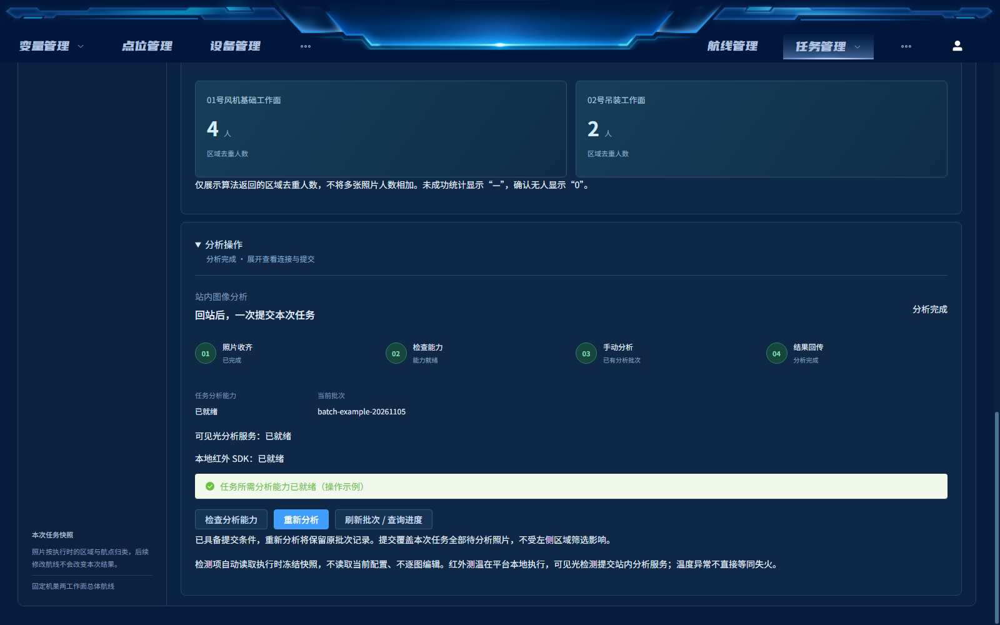

读图指引：展开分析操作，先检查能力，再使用“开始分析”或“重新分析”；“刷新批次 / 查询进度”用于核对已有请求和处理进度。图中的“已就绪”是演示状态。

### 7.2 手动提交分析

1. 确认媒体收齐、本地原图可读，待确认归属问题已处理，任务具有有效的冻结检测规则。
2. 检查分析能力通过后，点击“开始分析”，核对确认提示并提交。
3. 平台依据本次任务冻结规则选择照片和检测项目。可见光照片传到站内分析服务；红外温度分析由本部署端SDK完成。
4. 页面展示分析批次和进度。系统会查询结果，必要时点击“刷新批次 / 查询进度”。
5. 若提示“提交响应未确认”，先查询已有批次，按页面提供的原请求确认入口处理，不连续点击创建新批次。

左侧区域筛选只影响当前查看的照片和结果，不会把提交范围缩小为一个区域。一次提交针对该飞行任务所有满足规则且未排除的待分析照片。重新分析会形成新的批次，旧批次可供追溯。

### 7.3 查看可见光检测结果

选择目标分析批次，再选择工作面和照片。右侧对比原始采集照片与算法标注图，可点击“放大对比”；下方查看各检测项目的状态、人数或检测框等信息。可以按照片名称、航点或结果状态筛选。

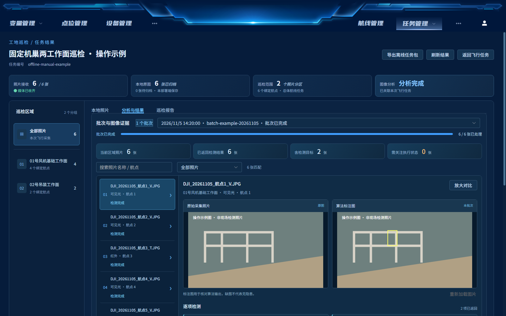

读图指引：上方批次选择器用于切换历史批次；中间照片列表选择单图；右侧显示同一张照片的原图和本批标注图。标注目标需结合原图人工复核。

“批次完成”表示该批次处理或结果取回已完成，不等于每个检测模型成功，更不等于现场没有隐患。部分检测不可用、失败或标注图缺失时，先查看具体项目和错误说明。

### 7.4 人数如何读取

单张照片中的人数用于解释该图的统计结果。同一工作面多个角度的去重人数由算法服务汇总返回，页面在工作面人数统计中显示。

例如同一工作面的三张照片分别为3人、3人和2人，而区域去重结果为4人，应使用该工作面的4人结果，不把单图相加成8人。不同工作面的人数也不能直接相加作为整个工地去重人数。

成功统计且无人显示“0”；模型不可用、失败或未得到可靠结果显示“—”，两者含义不同。区域汇总校验异常时，应核对报文和原图后再使用统计值。

### 7.5 查看红外温度异常

选择红外照片，查看最高、最低、平均温度、高温阈值、最小热点像素数和符合条件的热点区域。结果图标注为“本地测温热力图”，与可见光算法标注图区分。

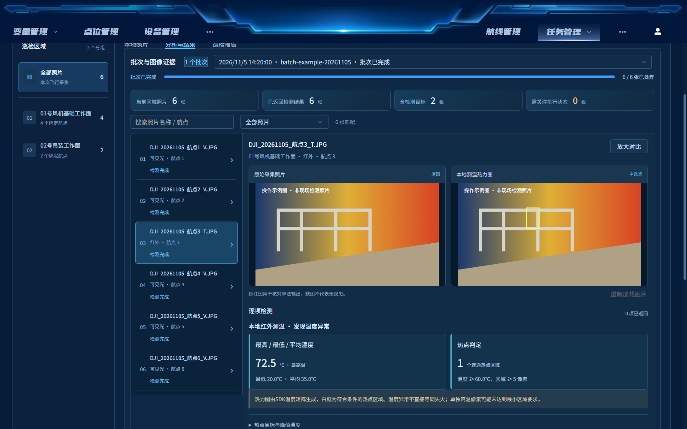

读图指引：选择列表中的红外照片，对照原图与本地热力图；向下查看温度统计和热点说明。图中的72.5℃等数值为演示值，不是现场结论。

最高温度可能来自单个小热点，而异常区域还受最小连通像素数限制。温度异常不直接等同于失火，需结合环境、物体特性和现场复核。热力图用于展示温度分布，不改变原始红外照片。

### 7.6 生成和下载Word报告

1. 切换“巡检报告”页签，找到需要出具报告的分析批次。
2. 对允许生成报告的批次点击“生成 Word 报告”。完成后状态变为“已生成”。
3. 点击“下载”，在浏览器下载目录取得.docx文件。
4. 打开报告，核对任务编号、分析批次、工作面、照片、检测状态及红外结果。由复核人员填写人工复核与处理记录。

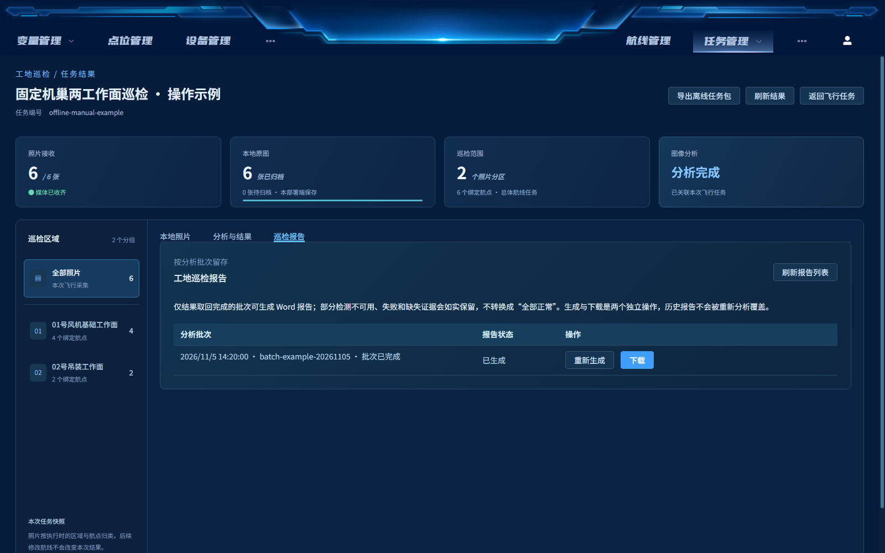

读图指引：“生成 Word 报告”与“下载”是两步；已有报告可点击“重新生成”。报告按批次留存，不能把不同批次的图和结论混在一起。

新版报告包含“东方电子股份有限公司”封面及落款、报告概述、工作面人数汇总、逐图证据、红外测温和人工复核记录。升级报告样式后，对已有批次重新生成即可使用新版格式，不必为了更新排版重新运行算法。

## 8 固定端、移动端操作清单

### 8.1 固定端每日巡检

1. 确认固定机巢定位、保存的覆盖范围及工作面状态。
2. 首次作业或需求改变时，先配置工作面、航线、检测规则，再新建计划。
3. 选择计划并由飞手检查后下发，在飞行任务中跟踪状态。
4. 飞行结束后等待照片收齐，补齐本地原图并检查归属。
5. 需要交接时导出离线任务包，将ZIP交给接收端；核对接收成功后仍保留必要的源端备份。

### 8.2 移动端转场巡检与回站

1. 出发前确认任务安排和本地存储空间。
2. 在施工区域页面选择预设驻车点，查看覆盖工作面及与当前机巢的直线距离。
3. 到达驻车位置并完成设备准备后，等待机巢实时定位更新，重新检查实际覆盖范围和航线高度。
4. 按新位置选择适用区域和计划，完成飞行及照片归档。旧航线高度不会自动随转场重算。
5. 到固定端交接时，按接收目录复制完整ZIP，点击“刷新并接收”，核对来源与照片。
6. 回站接入网络，分别检查各任务分析能力、提交分析、复核结果并下载报告。

### 8.3 完成标准

采集完成：飞行任务状态正确，照片数量核对完成，原图已保存。

交接完成：接收端列表出现对应来源任务，数量一致，原图可打开。

分析完成：核对批次、逐项检测状态、区域人数及图像证据；失败和不可用项已明确记录。

报告完成：下载对应批次报告，人工核对信息，填写复核及处理意见。

## 9 常见问题与处理

| 现象 | 优先检查 | 建议操作 |
| --- | --- | --- |
| 地图没有机巢 | 绑定设备、现场网络、定位上报 | 刷新机巢；等待有效定位，不使用驻车点替代 |
| 计划页没有工作面 | 是否选择机巢，范围是否已保存，是否完全覆盖 | 核对定位、半径及区域筛选 |
| KMZ无法关联区域 | 航点或航段越界、文件不支持、区域版本变化 | 按提示检查；跨工作面航线改用总体入口 |
| 航点复选框不可勾选 | 唯一拍照标识、后缀重复、动作解析 | 查看“绑定条件”，按平台提示处理执行版或修正文件 |
| 新规则没有作用于旧任务 | 计划冻结的是旧规则 | 修改规则后新建计划；旧结果重新分析仍沿用旧快照 |
| 照片无法打开或未归档 | 原图是否回传、存储空间及读写权限 | 收齐照片后补齐本地原图，必要时联系维护人员 |
| ZIP放入目录后列表未出现 | 是否本工作空间目录、是否复制完整、是否点击接收 | 使用界面实际目录，点击“刷新并接收”并查看回执 |
| 重复任务包显示跳过 | 相同来源任务已接收 | 在已有接收任务中查看，不重复建立结果 |
| 分析服务返回成功但能力检查失败 | 本地红外SDK或健康报文内容 | 看可见光与红外各自状态，处理具体原因 |
| 开始分析按钮不可用 | 收齐状态、归属、冻结规则、分析能力或活动批次 | 按页面提示补齐前置条件，刷新查询已有批次 |
| 批次完成但仍有提示 | 部分模型不可用、失败、缺少证据或统计校验异常 | 打开逐项结果核对，不将提示忽略为全部正常 |
| 人数显示“—” | 未请求、不可用或统计失败 | 查看状态说明；“—”不能当成0人 |
| 看不到温度数据 | 是否红外原图、规则是否开启、本地SDK是否成功 | 核对照片类型、计划快照及本地测温错误 |
| 不能生成报告 | 批次尚不满足报告生成条件 | 先查询分析和结果取回状态，再生成对应批次报告 |

向维护人员反馈时，提供页面名称、任务名称或编号、分析批次、操作时间和错误截图。无需提供账号密码或令牌。

### 手册维护说明

本版依据2026年11月5日本地代码和实际前端界面编写，采用操作示例截图，未把截图过程视为真实飞行或现场算法验收。旧开发记录中的“算法待接入”等阶段性描述不作为当前操作指引。现场培训可直接使用本手册；正式交付前可用相同图号替换现场截图，保留步骤结构。
